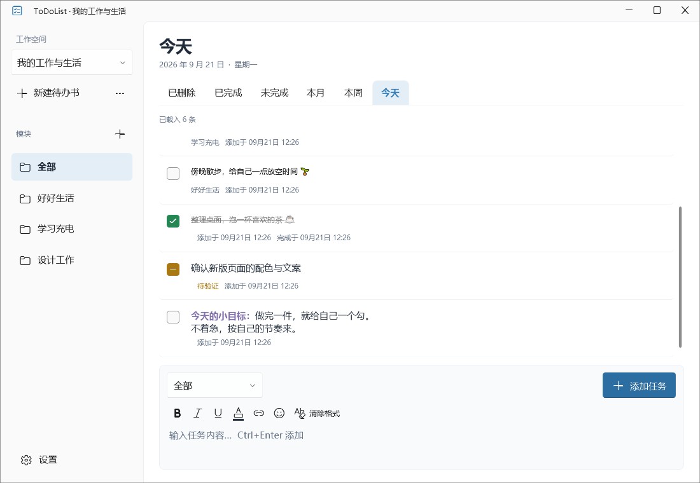

# ToDoList

本地优先的 Windows 待办应用，使用 .NET 10、WPF UI 4.3.0 与 SQLite。维护者：**H-J-F**；本项目代码采用 [MIT](LICENSE) 许可。

**本项目由 H-J-F 维护，开发过程中使用 AI 辅助进行代码编写、重构、测试及文档整理。已验证功能与环境范围见验证报告。**



## 获取与运行

仓库：[H-J-F/ToDoList](https://github.com/H-J-F/ToDoList)。[正式版本下载入口](https://github.com/H-J-F/ToDoList/releases)。**当前源码版本为 2.3.24。**发布包及对应版本说明以 GitHub Release 为准。

本地构建提供两版，均为 Windows x64：

| 包名 | 适用情况 |
| --- | --- |
| `Build/ToDoList-2.3.24-win-x64-lite/` | 精简版，需要安装 [.NET 10 Desktop Runtime x64](https://dotnet.microsoft.com/zh-cn/download/dotnet/10.0)，交付文件总量小于 50,000,000 字节 |
| `Build/ToDoList-2.3.24-win-x64-portable/` | 自带运行时，程序压缩为单个 EXE；无需预装 .NET，首次运行会解压必要原生组件 |

Lite 只包含一个 `ToDoList.exe`，缺少运行环境时由原生启动入口提示并提供微软下载入口。

在可写目录中双击 `ToDoList.exe`。全局只运行一个实例，再次启动任一版本会恢复并激活已有窗口；关闭按钮将窗口隐藏到托盘，双击托盘图标恢复，右键“退出 ToDoList”才会结束进程。无待保存内容时退出不恢复主窗口；需要处理未保存修改、草稿或错误时才显示窗口。本地构建只生成程序目录，不自动创建压缩包。两版均在程序同级 `Data` 保存任务和设置，数据互通；体积统计不包含用户数据及单独安装的共享运行时。请保留随程序提供的使用说明和许可证材料。当前构建**尚未进行代码签名**；可信签名及 Microsoft Store 为后续事项。

升级前关闭应用并备份整个 `Data`，解压新程序后保留原 `Data`。不要运行时手动替换数据库。默认使用本地空间；登录微云并授权后，可将账号工作区的笔记同步到该账号的个人微云空间。关于卡片通过默认浏览器打开公开仓库。

## 微云登录、授权与云存档须知

登录界面的提示为：**扫码授权即同意使用当前微云空间保存 ToDoList 云存档。** 点击左下设置按钮上方的圆形头像或名称，打开右侧“账号与同步”，再点击“微信登录微云”。在微云官方页面用微信扫码并确认权限与协议后，应用自动取得访问凭证。用户无需填写服务器地址、应用密钥或复制 Token。

未登录时显示灰色圆形人像图标和“未登录”，图标尺寸及文字位置与设置对齐。登录、切换账号、同步和退出操作统一放在账号面板中，外观设置独立保留。

默认在应用内的官方微云页面扫码授权；完成后自动关闭登录窗口。程序尝试从同一网页登录会话读取昵称和头像，仅在微云空间身份匹配时显示。官方 OAuth 本身仍只提供文件权限；资料缺失或官网变化时显示默认图标和“已授权”，不影响同步。此补充方式需要通过真实扫码验证，合成界面测试不能证明已取得真实微信资料。

内嵌登录需要 [Microsoft Edge WebView2 Runtime](https://developer.microsoft.com/microsoft-edge/webview2/)。Lite 与 Portable 都使用系统共享运行时，不捆绑浏览器。缺少运行时或官方页面不兼容时，可点击“使用系统浏览器”；程序不自动安装。浏览器授权后尝试恢复窗口，并提供“打开 ToDoList”链接（可能需要浏览器确认）。返回链接在普通运行环境按当前用户注册；隔离测试或手动指定数据目录时不覆盖已有注册。

- 云存档使用当前账号的个人微云容量，应用直接连接腾讯微云，不通过开发者自建的数据存储服务器。容量、会员权益、接口可用性和服务规则以微云平台为准。
- 云端统一放在 `ToDoList`：`Data` 为每台设备保留最新两份 DB，`Sync` 保存一份协议初始化 DB；上传校验成功后，多余的本设备 DB 自动移入微云回收站。文件数量不随同步次数累积，多设备离线修改仍可合并、处理冲突。清理失败会提示并在后续同步重试，本地仍可使用。
- 旧云格式迁移前请升级全部电脑并停止旧版本同步。新版验证、备份旧快照后转为 DB 存档；不要让旧版与新版同时同步。未知云文件不会被自动删除，`connection-check.json` 只是早期连接测试探针，日常同步不需要它。
- 首次扫码后加载云内容会展示加载阶段和进度，可点击“取消加载”；日常同步与撤回按需更新界面，不显示全屏刷新遮罩。
- 游客笔记保存在原 `Data`；每个账号在 `Data/Accounts/<账号空间标识>` 独立缓存。点击“导入本地笔记到当前账号”保留笔记 ID；同 ID 合并，不同 ID 同名保持独立，源笔记保留。名称变化不会生成额外笔记；不同版本可在“处理同步冲突”中选择。
- 自动同步默认每 5 分钟检查，可选择 5、10、15、20、25、30、60 分钟七档周期；旧设置中的 2、3、8 分钟自动回退为 5 分钟。启动检查后按周期运行。修改、撤回和结束编辑不再触发 5 秒同步，失败及暂缓等下一周期。先比较本地逻辑数据哈希，再检查云端最新版本；两端无变化不上传或下载 DB。
- 同步包含笔记、任务、模块、富文本、任务状态历史、回收站和笔记内设置。全局外观偏好、窗口位置、本地历史 Backup 和登录凭证不上传。
- 不同任务的修改自动合并。同一项数据发生不兼容修改时，在“处理同步冲突”中比较本地与云端版本，选择保留一个版本、保留双方为独立副本，或稍后处理。未解决的版本仍保留，其他数据可继续同步。笔记设置、状态历史等单值记录选择一个版本；笔记、模块和任务支持保留双方。
- 永久删除留下不含正文的同步标记，防止离线设备重新传回旧数据；本地永久删除仍不可通过回收站恢复。历史云存档和既有本地备份可能保留旧内容，永久删除不等于清除历史存档。
- 云端变更应用到本地前自动备份，正在编辑或有未提交草稿时暂缓应用。网络失败不会阻止本地保存；上传中的版本有独立待发送记录，重新启动后可继续。单个压缩对象上限 32MiB、解压快照上限 128MiB，超过限制会保留本地并提示。
- 授权有效 14 天，重启和自动刷新 Token 不延长；到期重新扫码，同一账号继续使用原本地笔记。旧凭证首次升级读取时起算 14 天。
- 退出微云会停止该账号同步并返回本地空间，账号本地缓存和已有云端存档继续保留；更换账号使用另一份工作区，不将上一账号的笔记自动上传给新账号。
- 凭证采用 Windows 当前用户 DPAPI 保护，保存在程序根目录 `Auth`，登录浏览器临时缓存位于 `Auth/Browser`；升级时迁移与当前 Data 对应的旧用户目录缓存，成功验证后清理旧凭证；不进入云存档或数据库导出。授权失效、凭证损坏或网络失败时仍加载已记住账号的本地笔记。新登录确认账号身份后，云目录初始化失败也保留该账号本地空间；尚未确认身份或取消登录不切换账号。授权失效后需重新微信登录恢复同步。用户可在微云官方授权管理页面撤销授权。

当前已验证两个真实微信微云账号的授权、空间隔离、原生文件传输及冲突同步。尚未取得针对独立 WPF 应用公开分发的明确平台说明，这不等于确认官方接口没有任何使用限制；对外发布前仍需核对当时适用的微云规则。验证入口、隔离数据与覆盖边界见 [云同步](docs/云同步.md) 和 [微云接入验证](docs/微云接入验证.md)。

项目交付目标包含后续 GitHub Release。当前开发轮次先构建本地 Lite 与 Portable；远程 Release 在明确安排发布的轮次执行，并核对平台规则和交付验收。

## 使用方法

首次启动点击“创建待办笔记”，标识名只能为 1–64 个 ASCII 英文字母或数字（可纯数字），大小写不敏感，不允许 Windows 保留名称；展示标题允许中文。每本笔记对应 `Data/<标识名>.db`，备份位于 `Data/Backup`。

| 操作 | 方法 |
| --- | --- |
| 新建、切换待办笔记 | 左上选择器及“新建待办笔记” |
| 导入、导出、删除 | 待办笔记操作菜单 |
| 隐藏、展示及恢复笔记 | 笔记菜单选择“隐藏当前笔记”；勾选“显示隐藏笔记”后选择笔记，再“取消隐藏当前笔记” |
| 新建模块 | 左侧模块目录的加号、右键菜单，或底部“新增模块” |
| 纯文本粘贴 | Ctrl+V 保留文字和换行，使用自动主题文字色；工具栏仍可设置格式 |
| 底部草稿切换 | 切换页签保留内容；切换具体模块同时更改任务归属；切换“全部”保留归属，不提示保存草稿 |
| 新增任务 | 选择模块，填写内容，Enter 或“添加任务”（兼容 Ctrl+Enter） |
| 换行及格式 | Shift+Enter 换行；工具栏或 Ctrl+B/I/U；支持颜色、链接与彩色表情 |
| 文字颜色 | 24 个预设色、自动跟随主题、最近 8 色、自定义 `#RRGGBB` |
| 表情 | 中文分类、每行 8 项、最近使用；也可用 Win+.；Esc 关闭面板 |
| 修改内容与模块 | 双击正文，可同时修改内容和所属模块；Enter 保存（兼容 Ctrl+Enter），Esc 取消 |
| 完成／恢复未完成 | 单击勾选框，或焦点在勾选框时按空格 |
| 待验证／取消待验证 | 长按勾选框 600ms，或 Shift+空格 |
| 删除／恢复 | 任务右键菜单或 Shift+F10，恢复至删除前状态 |
| 撤回最近修改 | 右下角提示的“撤回”；仅限最新任务或模块操作，进度条显示 4.5 秒机会，新修改替换旧机会 |
| 打开链接 | Ctrl+单击 |
| 已完成排序 | 右上排序入口悬停或键盘聚焦，选择添加／完成日期 |
| 账号与云同步 | 左下设置上方的圆形头像或名称；右侧面板提供登录、切换、同步、本地导入及退出 |
| 外观及关于 | 左下设置；再次点击设置、点击面板外或按 Esc 关闭；关于卡片可打开本仓库 |
| 查看所有任务 | 顶部最左“所有”，包含当前模块的全部状态任务 |
| 日历筛选 | “今天”右侧日历，选择整年／整月／整日后应用；再次点击、外部点击或 Esc 关闭 |
| 导出报告 | 页面右上“导出报告”，选择模块、状态、添加时间范围和 MD／DOCX／PDF，默认 MD |

任务和模块修改成功后，右下角提供 4.5 秒撤回机会，另等 0.5 秒淡出；仅限最新任务或模块操作。同步期间或完成后仍可在期限内撤回，变更等待手动或正常周期同步；相关记录已被其他修改改变时明确提示失败并保留数据。

账号面板同行显示 `上次同步：时间 | 耗时: X.XX 秒`。耗时仅保留本次运行的数据，重启后须再次成功同步才显示；自动同步周期使用方块滑块，七档数值分别对齐刻度，60 分钟选中时显示“同步周期：1 小时”。

正式版运行日志保存在程序目录 `Log`，与 `Data` 同层，账号面板可打开。日志按日滚动、保留七天，不记录正文或凭证。微云当日配额耗尽（117401）或临时限流会等待恢复；手动和重启不会绕过限制。笔记改名后，整本导出及报告默认文件名使用当前标题。

“全部”汇总当前笔记任务；新增或编辑时选“未分配模块”表示不归属具体模块。既有模块名称保持原样。

未完成包括黄色待验证，已完成只包括当前完成任务。已删除为可恢复的逻辑删除，使用红色图标、红色正文及红色删除线，不能编辑或勾选；恢复后撤销状态装饰，保留原富文本格式及原完成时间。已删除页签支持右键彻底删除，或开启多选后批量彻底删除；多选框在垃圾桶原位置显示，成功删除后自动退出多选，取消或失败保留选择；确认后不可恢复。模块支持重命名、删除、迁移到其他待办笔记及长按 500ms 拖动排序；迁移包含回收站和历史，同名时选择合并或改名；删除模块保留任务。待办笔记菜单支持重命名，保持 ID 与文件路径；删除前自动备份。隐藏状态保存在每本笔记的数据库中，并随账号同步，隐藏不删除内容、不停止同步。显示隐藏笔记后，标题旁标记“已隐藏”；展示开关在重启或切换账号后默认关闭。全部笔记隐藏时可从空白页入口重新展示。

“所有”不限制日期；今天、本周、本月及日历按**添加时间**筛选，包含所有状态；一周从周一开始。全部页签均为**上旧下新**，同时间按任务 ID 稳定排序。已删除按删除时间；已完成可按添加或完成时间；日期标题与排序依据一致。每条任务显示添加时间及适用的完成／删除时间。内容（含格式）或所属模块实际修改并保存后，会显示上次修改时间，悬停可查看秒数；删除模块导致任务变为未分配也计入修改。状态切换、删除和恢复不会改变该时间；无修改记录的任务不显示此项。

进入待办笔记、模块或页签时加载最新 200 条并定位底部；向上翻阅历史，向下返回较新任务。新增任务符合当前筛选时定位最新任务，不符合时提示其所在模块并保留当前视图。

富文本以结构化 JSON 和纯文本保存；表情仍存 Unicode，使用 Emoji.Wpf 绘制系统字体提供的彩色字形，无法绘制时保留原文。支持组合表情、肤色、复制剪切与撤销重做；字体所支持的字形随 Windows 版本而异。图片、附件及复杂文档布局不属于本版格式。

## 任务报告

“导出报告”分别选择全部／单个模块、所有／已删除／已完成／未完成（含待验证）、不限时间／整年／整月／整日／自定义起止日期。结束日包含全天，日期按本机时区和任务添加时间计算；默认沿用当前模块、状态和日期条件，格式每次默认 Markdown。

报告包含书名、筛选条件、导出时间、各状态数量，并按本地添加日期分组；每条任务先显示正文，再紧凑显示彩色状态、模块和添加／上次修改／完成／删除时间；无修改记录时省略上次修改时间。报告按添加时间从旧到新排序，不受列表已加载数量限制；零结果也可导出概要。报告从同一数据库快照生成，不包含尚未保存的草稿。

MD 为 UTF-8；DOCX 可用 Word 打开；PDF 自动换行分页，使用本机字体生成中文和彩色表情。三种格式默认使用未完成 `#00CAE5`、待验证 `#E6A409`、已完成 `#07E355` 和已删除红色。设置中的“导出文档标记颜色”支持三种状态颜色的方块预览及自定义；这些设置只影响导出，任务勾选框由独立主题资源提供颜色。已有自定义导出颜色会保留。导出成功后会打开报告所在目录并选中文件；若目录已经打开则激活现有资源管理器窗口。DOCX 的表情外观随阅读软件而异。导出过程无需安装 Office、连接网络或使用 PDF 打印机，原有整书 `.db` 导出继续用于备份。报告须保存在 Data 目录之外。

## 导入与备份

- 导出使用 SQLite 备份 API，包含已提交的 WAL 内容。
- 导入以数据库内部标识判断身份，修改文件名不会改变身份。
- 同 ID 的笔记可合并、覆盖或取消；不同 ID 同名保持独立。实际改动库先备份，重复导入相同内容不产生新笔记或重复记录。
- 合并按记录 ID 和可靠共同基线判断变化；没有可靠基线的不同版本全部保留供处理冲突，不按最后修改时间覆盖。历史事件按 ID 去重。
- 同 ID 模块保持关联，不同 ID 模块保留独立身份；全局外观设置不参与导入。
- v1/v2/v3/v4 数据库升级为 v5 前先备份；v5 增加稳定笔记身份与同步删除标记，独立修改时间不补填历史值。导入旧库只升级暂存副本，不改源文件。拒绝损坏、未知新版及内容不一致的数据库。
- 迁移或替换失败时保留原库。Data 不可写会提示，不会擅自换目录。

## 界面与性能

编辑已有待办时，点击外部、切换软件或最小化都会自动保存并退出；工具栏和编辑弹窗仍可继续使用。保存失败保留输入内容。后台同步仅更新变化的记录，不重建整个列表或抢输入焦点；编辑或草稿未完成时暂缓应用。

WPF UI 的 FluentWindow、TitleBar、CardAction、CalendarDatePicker、按钮、文本框、ContentDialog、Snackbar；ComboBox、CheckBox、菜单、滚动条采用该库为 WPF 原生控件提供的样式。系统托盘使用 Windows 原生 NotifyIcon，菜单继续采用 WPF UI 样式。功能图标使用 SymbolIcon，不使用字符拼凑箭头。

统一“主题”选择：跟随系统、经典浅色、经典深色，以及薄荷奶油、暮色金、午夜摩卡、丁香雾、暖灰鼠尾草、珊瑚蜜桃、晴空蔚蓝、深海夜蓝八套候选。每套候选固定明暗，背景、正文、控件与强调色一起切换，不再单独设置强调色；“跟随系统”在经典浅色与经典深色间切换。支持 12／14／16／18 DIP、紧凑／舒适及减少动态效果。正文使用系统 Microsoft YaHei UI，Normal 字重，Display + ClearType；图标使用库字体、Ideal + Grayscale。实际清晰度也受屏幕 DPI、ClearType 校准及系统字体影响，不分发 Windows 字体文件。

旧外观设置按原显示模式迁移到对应经典主题，字体、间距、最近颜色等偏好保留；旧强调色不再生效。自动文字色随主题更新，显式富文本颜色和报告标记颜色保留。八套新配色尚待截图评审决定保留名单，来源、预览入口与验收说明见 [主题与预览](docs/主题与预览.md)。

SQLite 索引与双向游标分页，每批 200 条，最多 2,000 条／32MiB 内容缓存，Recycling 虚拟化；任务编辑共用一个空闲时预热的 RichTextBox，不为每行创建编辑器。状态持久化与历史写入同事务；每行独立退出动画，容器复用清理动画。数据查询在后台执行，旧请求取消且按查询代号隔离。

## Rider 开发与本地打包

安装 Windows .NET 10 SDK，用 Rider 打开 `ToDoList.sln`，启动 `ToDoList.App`。

```powershell
.\Build.bat
# 仅在明确指定版本时使用：
.\Build.bat --version 2.4.0
```

统一入口会在修改完成后自动递增补丁版本，检查文档、编译、测试并发布两版；无改动重复执行不递增。已有同名程序目录会保留，新输出位置见 `Build/latest.json`。详见 [构建发布](docs/构建发布.md)。

构建脚本可选 `Lite`、`Portable` 或 `Both`，统一输出到项目一级目录 `Build`（与 `artifacts` 同级），不存在时自动创建，并记录程序体积。需要保留多个构建时可指定 `-OutputRoot ./Build/自定义目录`；禁止输出到 Build 之外。已有程序目录会拒绝覆盖，避免破坏 Data。更新前关闭应用并备份整个 Data，移除旧程序目录后重新构建，再复制 Data 到新程序同级目录；不要合并不同待办笔记数据库文件。脚本不生成 ZIP、上传、创建标签或发布 Release。使用 Release、关闭调试符号、保留中文及中性资源，不采用不受支持的 WPF 裁剪。

测试工具与实际覆盖范围见 [筛选与报告回归](docs/VALIDATION-REPORTS.md)、[字体与构建回归报告](docs/VALIDATION-TYPOGRAPHY.md)、[2.1 验证报告](docs/VALIDATION-2.1.md)，历史报告见 [VALIDATION](docs/VALIDATION.md)。应用支持 `--data-dir <独立测试目录> --ui-smoke`、`--ui-typography`、`--ui-perf`、`--ui-features` 和 `--ui-demo`；测试必须使用隔离目录，不能指向真实数据。

性能专项 `--ui-perf` 要求 `--data-dir` 为首个参数并指向当前工程 `artifacts` 内的独立目录，使用独立实例，不激活现有用户进程。附加 `--memory-checks` 在全新空目录生成一万条合成任务，执行三轮分页、筛选、编辑及笔记切换，静置五分钟，最后检查合成登录浏览器关闭后子进程退出；输出同层 `memory-results.json`。记录工作集、私有提交量、托管对象和最近一次 GC 堆信息，不强制回收或裁剪工作集；短时结果不能单独证明不存在泄漏。内存分析与本轮验证见 [同步周期与内存分析](docs/VALIDATION-INTERVAL-MEMORY.md)。

## 版权与第三方

Copyright (c) 2026 H-J-F。本项目的 MIT 不替代第三方许可。完整清单见 [THIRD-PARTY](docs/THIRD-PARTY.md)，实际解析版本及包哈希见 [DEPENDENCIES.json](docs/DEPENDENCIES.json)，许可原文位于 [docs/licenses](docs/licenses)。

尤其注意：**Emoji.Wpf 0.3.4 与 Stfu 为 WTFPL，并非 MIT**。WPF UI 及 Fluent System Icons 为 MIT。内置 Typography、Unicode 数据、SQLite 和便携版 .NET 运行时的各自声明随两版程序附带。

## 项目维护

协作规则见 [AGENTS](AGENTS.md)，项目入口见 [项目架构](docs/项目架构.md)，文档与构建同步见 [项目闭环](.codex/项目闭环文档.md)，自动触发配置及信任要求见 [HOOKS](.codex/HOOKS.md)。
